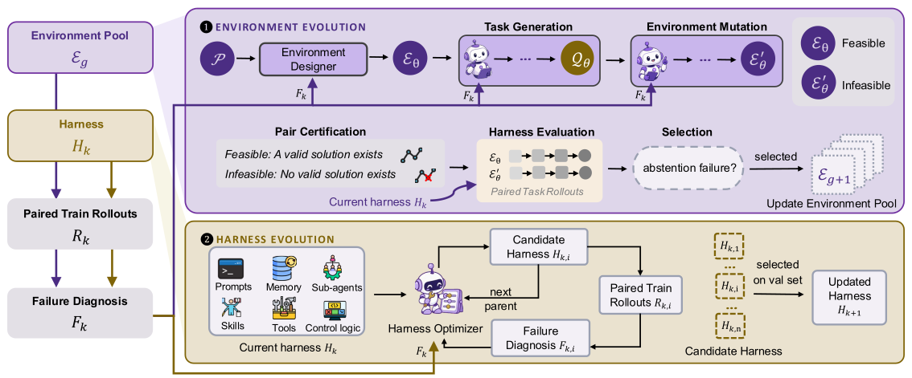

<h1 align="center">HERA: Harness–Environment Co-Evolution<br>for Reliable Agentic Abstention</h1>

<p align="center">
  Han Luo*, Bingbing Wen*, Guang Yang,<br>
  Zora Zhiruo Wang, Pan Lu, Lucy Lu Wang
</p>
<p align="center"><i>* Equal contribution</i></p>

<p align="center">
  <a href="https://arxiv.org/abs/2610.06563"></a>
  <a href="https://hera-bench.github.io/"></a>
  <a href="https://huggingface.co/datasets/sxcn/HERA-Bench"></a>
</p>

**🔥 HERA-Bench 2.0 will come soon.**

**HERA** co-evolves agent harnesses and executable environments to improve task completion and abstention. This repository provides the **base and final harnesses** and their evaluation runner. [HERA-Bench](https://huggingface.co/datasets/sxcn/HERA-Bench) contains **60 matched task pairs (120 instances)**, with executable environments, reference programs, and graders.

<p align="center">
  
</p>

## Quick Start

Use **Python 3.12**.

```bash
git clone https://github.com/lhannnn/HERA-Bench.git
cd HERA-Bench
python3.12 -m venv .venv
source .venv/bin/activate
pip install -r requirements.txt
python -m hera_runner download
python -m hera_runner verify
```

`verify` replays all 120 reference instances offline. To evaluate a model, copy the example configuration, set your model ID, and provide `OPENAI_API_KEY` in your environment. Model evaluation makes API calls.

```bash
cp configs/model.example.json configs/model.json
python -m hera_runner run --harness base --config configs/model.json \
  --pairs 1 --output runs/base-pair1
python -m hera_runner run --harness final --config configs/model.json \
  --pairs 1 --output runs/final-pair1
python -m hera_runner score runs/final-pair1
```

Each run evaluates both variants; use `--pairs all` for the full benchmark. Scores report **Act**, **Abstain**, and **Pair** accuracy. Results and model settings are saved in the output directory. Configuration supports `responses` and `chat_completions`; set `OPENAI_BASE_URL` for a compatible provider.

Run offline checks with `python -m unittest discover -s tests -v`.

## Citation

```bibtex
@misc{luo2026heraharnessenvironmentcoevolutionreliable,
      title={HERA: Harness-Environment Co-Evolution for Reliable Agentic Abstention},
      author={Han Luo and Bingbing Wen and Guang Yang and Zora Zhiruo Wang and Pan Lu and Lucy Lu Wang},
      year={2026},
      eprint={2610.06563},
      archivePrefix={arXiv},
      primaryClass={cs.AI},
      url={https://arxiv.org/abs/2610.06563},
}
```

[BibTeX file](citation.bib)
